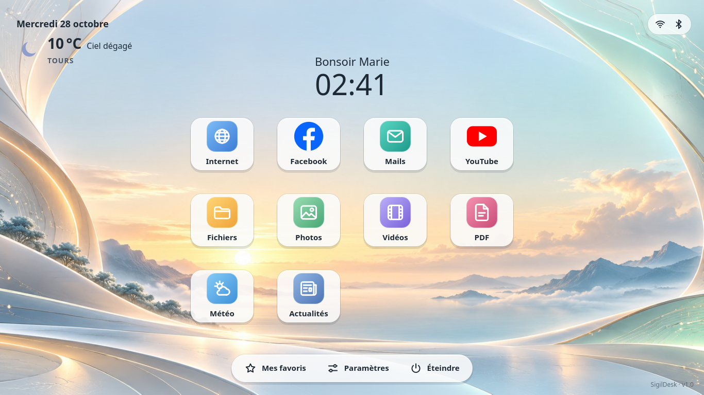
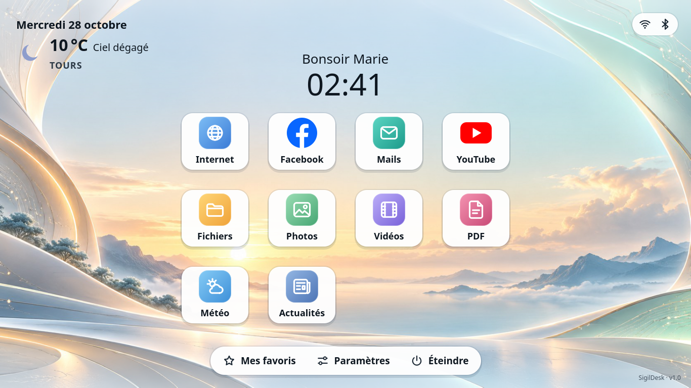
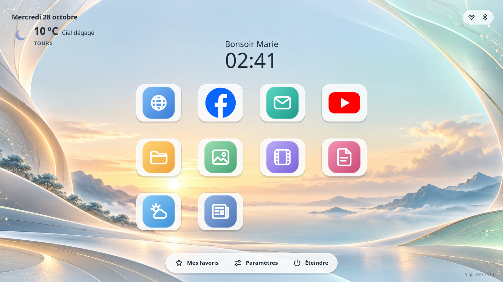
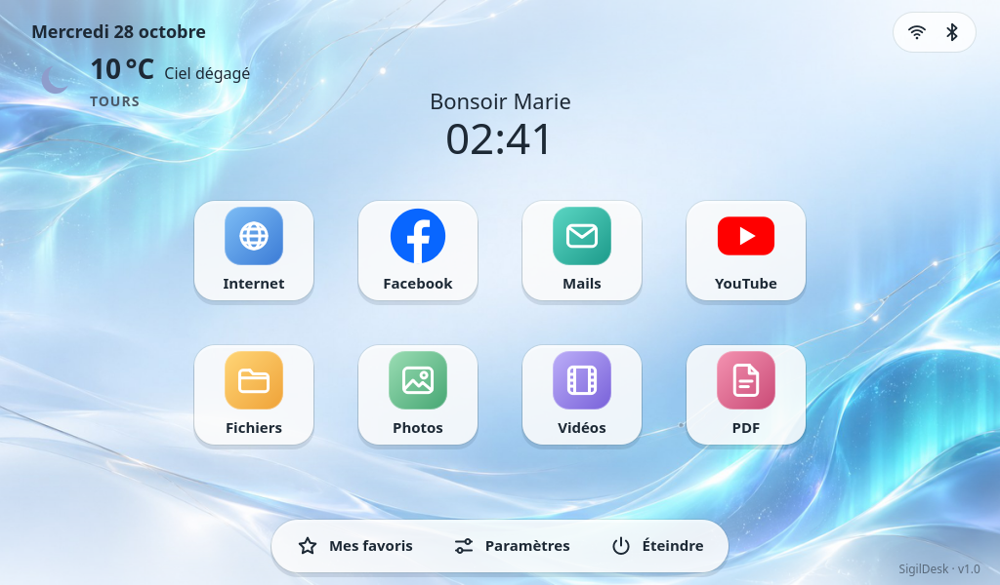
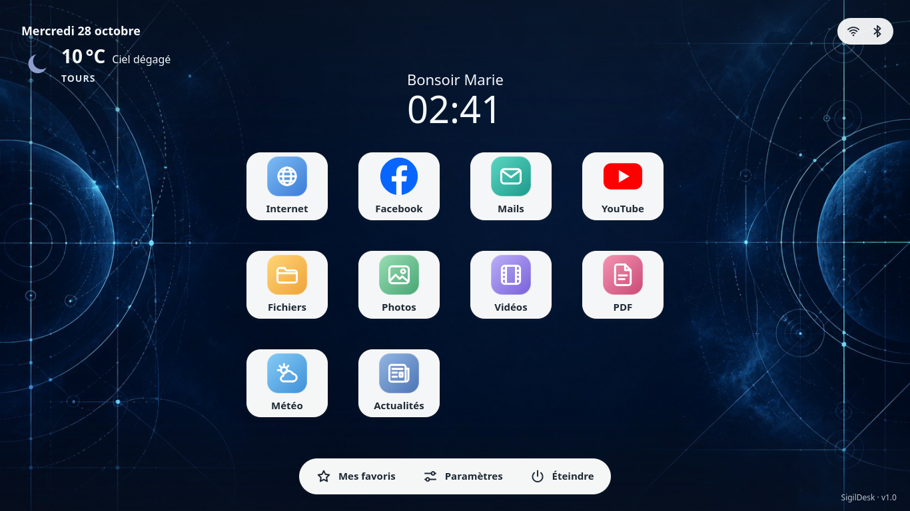
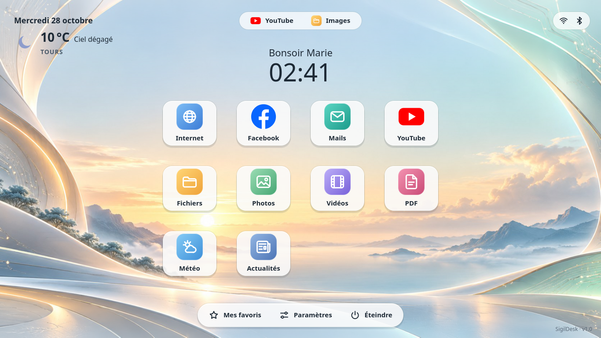
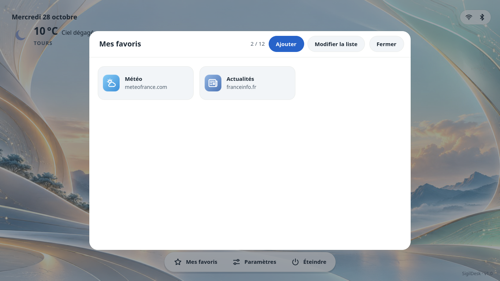
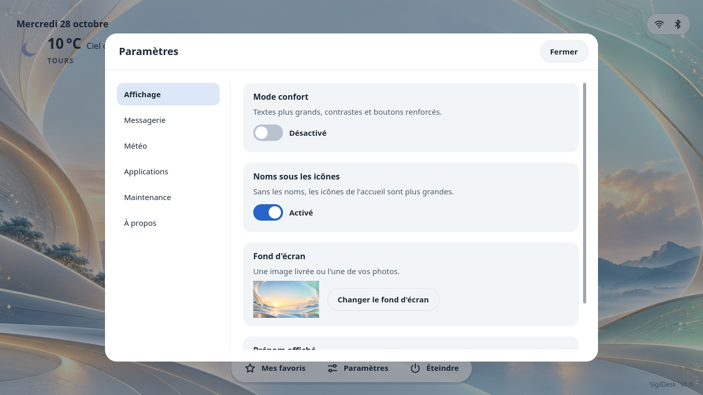
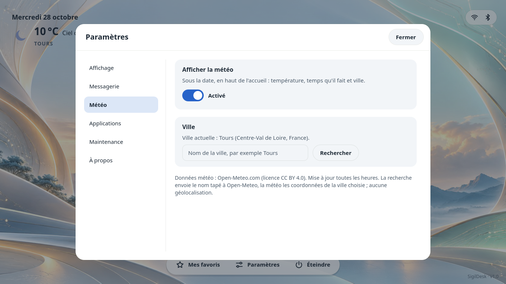

# SigilDesk

[](https://github.com/Ninde-beren/sigildesk/actions/workflows/tests.yml)
Code source publié ; licence « tous droits réservés, usage non commercial » (voir [LICENSE](LICENSE)).

Un accueil simple, façon tablette, pour un ordinateur portable modeste sous
Lubuntu 26.04 / LXQt. Il est pensé pour une personne qui vient de Windows et
veut aller droit à l'essentiel : Internet, Facebook, mails, YouTube, fichiers,
photos, vidéos, PDF.

SigilDesk **ne remplace rien**. C'est une fenêtre plein écran posée sur LXQt.
Il lance les applications déjà présentes : Chromium, PCManFM-Qt, LXImage-Qt,
VLC ou mpv, qpdfview. Il ne touche ni à la session, ni au gestionnaire de
fenêtres, ni à SDDM, ni à GRUB, ni au fond du bureau LXQt. S'il s'arrête,
le bureau LXQt est dessous, intact.

Version 1.0. Machine visée : ASUS E402SA (Celeron N3060, 4 Go de RAM, écran
1366×768, pavé tactile, sans écran tactile).



| Mode confort | Sans les noms | Écran 1024×600 | Fond sombre |
|---|---|---|---|
|  |  |  |  |

| Fenêtres ouvertes | Mes favoris | Paramètres | Météo |
|---|---|---|---|
|  |  |  |  |

Ces captures sont produites par l'application elle-même (`--screenshot`, rendu
Qt hors écran, `scripts/capture.py`). Rien n'est dessiné à part.

## Ce que fait SigilDesk

- **Accueil** : en haut à gauche, la date et, juste dessous, la météo posée sur
  le fond (grande icône, température, conditions, ville). À droite, une pastille
  d'état : icônes Wi-Fi selon la force du signal, Bluetooth, pile de batterie
  avec le pourcentage et un éclair en charge. Au centre, la salutation et
  l'heure. Puis la grille 2 × 4, avec les services web en haut (Internet,
  Facebook, Mails, YouTube) et l'ordinateur en bas (Fichiers, Photos, Vidéos,
  PDF). Une troisième rangée reprend les quatre premiers favoris, dans l'ordre
  choisi dans *Mes favoris*. Elle s'affiche quand l'écran a la place, comme à
  1366×768 ; à 1024×600, elle est masquée. Dock en bas : *Mes favoris*, *Paramètres*, *Éteindre*. Signature
  `SigilDesk · v1.0` en bas à droite. Option *Noms sous les icônes* : sans les
  noms, les icônes remplissent les tuiles.
- **Web** : ouvert dans Chromium, ou dans le navigateur du système à défaut.
  Facebook, Mails et YouTube s'ouvrent dans Chromium en fenêtre d'application,
  sans barre d'adresse (`--app=`). Internet garde une fenêtre normale. L'adresse
  est passée comme argument séparé, sans shell. La messagerie n'est pas
  présumée : on la choisit dans *Paramètres › Messagerie* (Gmail, Outlook,
  Orange, Free, SFR, La Poste, Yahoo ou une autre adresse).
- **Fichiers** : les tuiles locales ouvrent les dossiers dans PCManFM-Qt (miniatures
  dans Images). Un double-clic suit les associations standards (MIME) :
  LXImage-Qt, VLC ou mpv, qpdfview. Aucun lecteur n'est réimplémenté.
- **Fond d'écran** : cinq fonds livrés (dont « Brume », un dégradé uni) ou une
  image importée en JPEG, PNG ou WEBP. Aperçu, puis *Appliquer* ou *Annuler*.
  L'image est recadrée au centre, sans étirement, et le choix est mémorisé.
  L'image importée est copiée proprement dans `~/.local/share/sigildesk/wallpapers/` :
  redimensionnée, sans métadonnées EXIF ni GPS, l'original intact. Elle ne
  dépend donc plus de la clé USB. Le fond du bureau LXQt ne change pas.
- **Mes favoris** : jusqu'à 12 liens http(s) validés, avec un pictogramme livré.
  On peut les ajouter, modifier, réordonner ou retirer (avec confirmation).
  Aucun favicon téléchargé, aucun cookie, aucun cloud.
- **Mode confort** (*Paramètres › Affichage*) : textes de 18 à 20 px au lieu de
  14 à 16, tuiles et boutons plus grands, contrastes et anneau de focus
  renforcés. L'effet est immédiat, réversible et mémorisé. L'échelle de LXQt
  ne change pas.
- **Clavier** : Tab, flèches, Entrée, Échap ; l'anneau de focus est visible
  partout.
- **Maintenance** : `Ctrl+Alt+M` (réglable) réduit SigilDesk pour laisser LXQt
  accessible. *Paramètres › Maintenance* permet de réduire ou de quitter.
  L'entrée du menu LXQt ramène la fenêtre existante (une seule instance).
- **Extinction** : une seule confirmation, celle de SigilDesk. Ensuite, la
  session LXQt éteint proprement par D-Bus (`org.lxqt.session.powerOff`, qui
  ferme les applications puis passe par systemd-logind), sans la seconde boîte
  de `lxqt-leave`. Si la session refuse, `lxqt-leave --shutdown` prend le
  relais ; hors LXQt, un guide vers le menu s'affiche au lieu d'une fausse
  action.
- **Mises à jour** : elles s'installent seules (voir « Mises à jour » plus
  bas). Quand un redémarrage est nécessaire, SigilDesk propose « Redémarrer
  maintenant » ou « Plus tard » ; il redemande quatre heures après, ou au
  prochain démarrage.
- **Fenêtres ouvertes** : en plein écran, SigilDesk cache la barre des tâches
  de LXQt. Une barre à part, en haut au centre du bandeau, montre donc les fenêtres
  restées ouvertes (YouTube, un dossier, une vidéo…), et un clic y ramène.
  Une tuile dont la fenêtre est déjà ouverte la ramène au premier plan au lieu
  d'en ouvrir une seconde. Le relevé passe par `wmctrl` (session X11, Openbox)
  toutes les 2 s, et seulement quand l'accueil est au premier plan.
- **Habillage Sigilys system** : le logo de Lubuntu est remplacé par le
  « Sceau » Sigilys sur l'écran de démarrage et d'arrêt (thème Plymouth) et
  sur le bouton du menu LXQt (`install-branding.sh`, annulable avec
  `remove-branding.sh`).
- **Météo** : température, icône, conditions et ville, sous la date. Un
  clic ouvre *Paramètres › Météo* : afficher ou masquer, chercher une ville par
  son nom, choisir parmi les résultats. Aucune géolocalisation. Voir la
  section « Météo » plus bas.

## Dépendances

Sur Lubuntu 26.04 (vérifié dans un conteneur Ubuntu 26.04 : PySide6 6.10.2,
Python 3.14), à installer **une fois**, depuis un compte administrateur.
Le script demande confirmation avant d'installer quoi que ce soit :

```bash
scripts/install-system-deps.sh
```

Il installe :
- les paquets de [scripts/apt-packages.txt](scripts/apt-packages.txt) : PySide6
  et les modules QML, `wmctrl` (fenêtres ouvertes) ; puis ceux de
  [scripts/apt-packages-asus.txt](scripts/apt-packages-asus.txt), propres à la
  machine : **VLC**, le lecteur vidéo attendu par la tuile Vidéos (Lubuntu le
  livre, le paquet le garantit), et **`i965-va-driver`**, le pilote VA-API du
  Celeron N3060, sans lequel VLC décode H.264 et HEVC en logiciel et une vidéo
  1080p saccade ou se fige (`vainfo` sert à le vérifier) ;
- `qpdfview-translations`, la traduction du lecteur PDF. Lubuntu 26.04 l'a
  déjà ; c'est ici une simple garantie. qpdfview suit la langue de la session :
  il n'est en anglais que dans une session anglaise, comme la session live ;
- `language-pack-fr` ;
- les mises à jour automatiques complètes (section « Mises à jour ») ;
- **Chromium** en snap, seule forme proposée sur Ubuntu 26.04. Sans lui,
  Facebook, Mails et YouTube s'ouvrent dans Firefox avec une barre d'adresse.

Pour une interface entièrement en français, il suffit de choisir *Français* à
l'installation de Lubuntu : SigilDesk ne change ni la langue ni le fuseau
horaire du système.

Lubuntu fournit déjà PCManFM-Qt, LXImage-Qt, qpdfview, VLC et Firefox, avec les
bonnes associations de fichiers (vérifié dans la VM). Pour contrôler :

```bash
scripts/check-deps.sh
```

## Développement

```bash
uv venv .venv && uv pip install --python .venv/bin/python -r requirements-dev.txt
./run.sh --windowed --size 1366x768
./run.sh --windowed --size 1024x600 --root /tmp/essai-sigildesk   # réglages jetables
./run-tests.sh                                                     # 178 tests, ~25 s
.venv/bin/ruff check sigildesk tests scripts                       # lint (config dans pyproject.toml)
```

`--root DOSSIER` regroupe réglages, données, cache et journal dans un dossier
d'essai. `--no-network` coupe toute requête réseau (tests).
`--software` force le rendu logiciel, `--doctor` affiche le diagnostic.

Validation QML :

```bash
.venv/lib/python3*/site-packages/PySide6/qmllint --unqualified disable sigildesk/qml/Main.qml sigildesk/qml/components/*.qml
```

### Environnements alignés sur la cible

- **Conteneur Ubuntu 26.04**, avec les paquets PySide6 de la distribution :
  tests, diagnostic et captures. Le rapport sort dans `build/lubuntu-26.04/`.

  ```bash
  scripts/test-lubuntu.sh
  ```

- **Machine virtuelle QEMU/KVM** à partir de l'ISO Lubuntu 26.04.1 : 4 Go de
  RAM, 2 cœurs, écran 1368×768 (la VGA de QEMU impose un multiple de 8). Une
  clé USB virtuelle contient SigilDesk, `vm-installe.sh` et des fichiers
  d'essai (JPEG, PNG, WEBP, MP4 720p, PDF). Elle sert à valider la session
  LXQt (plein écran, raccourci, extinction, autostart). Elle ne dit rien des
  performances d'un N3060.

  ```bash
  .venv/bin/python scripts/vm-cle-usb.py
  scripts/vm-lubuntu.sh live ~/Downloads/lubuntu-26.04.1-desktop-amd64.iso
  ```

  Dans la VM : *Try Lubuntu*, puis `Ctrl+Alt+T` et :

  ```bash
  udisksctl mount -b /dev/sda1; bash /run/media/$USER/*/vm-installe.sh
  ```

  `scripts/vm-qmp.py` (capture d'écran, frappe, clic) pilote la VM depuis l'hôte.

## Installation sur l'ASUS

Copier le dépôt sur la machine (clé USB ou `git clone`), puis, en tant
qu'utilisateur normal :

```bash
scripts/install-user.sh
```

Le script copie l'application dans `~/.local/share/sigildesk/app` (elle ne
dépend plus de la clé). Il pose aussi le lanceur `~/.local/bin/sigildesk`,
l'entrée de menu *Accessoires › SigilDesk*, qui sert aussi à relancer, l'icône
et l'ouverture automatique à l'ouverture de session
(`~/.config/autostart/sigildesk.desktop`, `OnlyShowIn=LXQt`). Pas de sudo,
aucun changement dans LXQt. On peut le relancer pour mettre à jour.

Pour essayer à la main avant de laisser SigilDesk s'ouvrir seul :

```bash
scripts/install-user.sh --sans-autostart
~/.local/share/sigildesk/app/scripts/enable-autostart.sh    # quand tout va bien
~/.local/share/sigildesk/app/scripts/disable-autostart.sh   # pour annuler
```

Désinstaller (réglages, favoris, fonds importés et cache météo conservés ;
`--purge` les efface après confirmation ; le profil du navigateur n'est jamais
touché) :

```bash
~/.local/share/sigildesk/app/scripts/uninstall-user.sh
```

### Retrouver le bureau LXQt

`Ctrl+Alt+M`, ou *Paramètres › Maintenance*. En cas d'écran noir ou de blocage :
[docs/recuperation.md](docs/recuperation.md). En bref, depuis une console
texte (`Ctrl+Alt+F3`) :

```bash
rm -f ~/.config/autostart/sigildesk.desktop
systemctl reboot
```

## Réglages

`~/.config/sigildesk/config.json` : schéma versionné, validé strictement, écrit
de façon atomique. Les valeurs par défaut sont dans [config/default.json](config/default.json).
Le fichier ne contient aucune commande : seulement des choix parmi des listes
fixées dans le code et des adresses http(s). Un fichier abîmé est mis de côté
et remplacé par les valeurs par défaut. Un fichier écrit par une version plus
récente n'est jamais écrasé. Aucune donnée sensible n'y figure.

| Clé | Rôle |
|---|---|
| `user_name` | prénom de la salutation (facultatif) |
| `browser` | `auto` (Chromium si présent), `chromium`, `firefox`, `systeme` |
| `web.internet`, `web.facebook`, `web.youtube` | adresses des tuiles web |
| `web.mail` | `{"provider": "orange", "url": ""}`, ou `"autre"` avec une adresse |
| `folders.files/photos/videos/pdf` | `home`, `documents`, `downloads`, `pictures`, `videos`…, ou le chemin absolu d'un dossier (clé USB, disque externe) choisi dans *Paramètres › Dossiers* |
| `appearance.comfort`, `appearance.wallpaper`, `appearance.show_labels` | mode confort, fond choisi, noms sous les icônes |
| `favorites` | jusqu'à 12 `{name, url, icon}` |
| `maintenance.shortcut` | raccourci de maintenance, deux modificateurs parmi Ctrl, Alt, Meta |
| `window.mode` | `plein-ecran` ou `fenetre` |
| `weather.enabled`, `weather.city` | météo affichée, ville choisie (nom, région, pays, latitude, longitude) |

Schéma en version 3 : un fichier des versions 1 et 2 est migré automatiquement au
démarrage (v2, 2026-10-28 : météo et noms sous les icônes ajoutés, activés ;
v3, 2026-11-01 : les dossiers acceptent un chemin absolu, le contenu ne change pas).

**Icônes personnalisées** : déposer `internet.svg` (ou `.png`), `mail.svg`, etc.
dans `~/.local/share/sigildesk/icons/`. Les noms sont ceux de
`sigildesk/resources/icons/`, et `scripts/build-icons.py` régénère les icônes
livrées.

## Mise en veille

Par défaut, LXQt verrouille l'écran avant chaque mise en veille avec
`xdg-screensaver lock`. Or Lubuntu 26.04 ne fait que *recommander* un écran de
verrouillage (xscreensaver) ; s'il manque, le réveil affiche « Erreur de
l'économiseur d'écran » sans rien verrouiller (constaté sur l'ASUS le
2026-10-28). Dans ce cas, `install-user.sh` coupe ce verrouillage
(`lock_screen_before_power_actions=false` dans `~/.config/lxqt/session.conf`,
la case de *Préférences LXQt › Paramètres de session*). Au réveil, on retrouve
directement l'accueil, sans mot de passe. Si un verrouilleur est installé, rien
ne change. `uninstall-user.sh` rétablit le réglage d'origine, et seulement
s'il a été changé par SigilDesk (`scripts/session-lock.py`).

## Mises à jour

Le but : que l'ordinateur reste à jour sans aide.

- **Système** : Lubuntu applique déjà seul les mises à jour de sécurité
  (`unattended-upgrades`). `install-system-deps.sh` y ajoute les mises à jour
  courantes et le ménage des anciens noyaux, une fois par jour, avec
  [data/52sigildesk-mises-a-jour](data/52sigildesk-mises-a-jour). Il installe
  aussi `update-notifier-common`, qui signale quand un redémarrage est
  nécessaire. Il n'y a jamais de redémarrage automatique.
- **Snaps** (Chromium, Firefox) : ils se mettent à jour d'eux-mêmes, quatre
  fois par jour, par snapd.
- **Notificateurs de Lubuntu** (`lubuntu-update-autostart`, notificateur de
  Discover) : ils demandaient un mot de passe administrateur. Ils sont masqués
  pour l'utilisateur seulement, par un fichier d'autostart `Hidden=true` dans
  `~/.config/autostart/` ; aucun fichier de Lubuntu n'est modifié.
- **Redémarrage** : SigilDesk vérifie toutes les 30 minutes
  `/run/reboot-required` et la présence d'un noyau plus récent que celui en
  cours. Si besoin, il propose de redémarrer par la session LXQt.
  *Paramètres › Maintenance* montre l'état et la dernière passe.
- **Annuler** : `scripts/disable-auto-updates.sh` retire le réglage et rétablit
  les notificateurs. Lubuntu revient alors aux mises à jour de sécurité seules.

## Météo

Le service est séparé de l'interface, avec un module par rôle :

| Module | Rôle |
|---|---|
| `domain/weather.py` | métier : ville, conditions, libellés français des codes WMO |
| `infra/open_meteo.py` | fournisseur : adresses d'appel, lecture des réponses |
| `infra/weather_cache.py` | cache horodaté `~/.cache/sigildesk/meteo.json` |
| `ui/weather_service.py` | orchestration Qt et réglages |
| `WeatherWidget.qml` | présentation |

Changer de fournisseur revient à écrire une autre classe qui suit
`weather.WeatherProvider`.

- Seules `temperature_2m`, `weather_code` et `is_day` sont demandées.
- Les requêtes sont asynchrones (`QNetworkAccessManager`, délai de 15 s), sans
  fil ni processus supplémentaire.
- Au démarrage, la dernière donnée en cache s'affiche, puis une actualisation
  est lancée. Elle se répète toutes les 60 minutes ; après un échec, un nouvel
  essai a lieu au bout de 15 minutes.
- Hors connexion, la dernière donnée s'affiche avec son heure (« Mis à jour hier
  à 18:05 »). Sans aucune donnée, le widget indique « Météo indisponible ».
  Une erreur réseau n'interrompt jamais SigilDesk.
- Désactivée, la météo ne fait plus aucune requête.
- Ce qui sort de l'ordinateur : le nom tapé, pour la recherche ; les
  coordonnées de la ville choisie, pour la météo.

**Licence et restrictions d'Open-Meteo** (vérifiées le 2026-10-28) : les
données sont sous licence CC BY 4.0. L'attribution « Données météo :
Open-Meteo.com » figure dans *Paramètres › Météo* et *À propos*. L'API
gratuite, sans clé, est réservée à l'**usage non commercial** : moins de
10 000 appels par jour, 5 000 par heure et 600 par minute, sans garantie de
disponibilité. SigilDesk en fait au plus 24 par jour et par ordinateur, et son
usage est non commercial (voir [LICENSE](LICENSE)). Une distribution
commerciale imposerait un abonnement Open-Meteo, avec une clé et l'adresse
`customer-api.open-meteo.com` (même syntaxe d'appel).

## Licence

© 2026 Sigilbo — Antoine OBLIGIS. Tous droits réservés, usage non commercial
uniquement ([LICENSE](LICENSE)). Les logos Facebook et YouTube appartiennent à
Meta Platforms et à Google ; ils ne servent qu'à désigner leurs services.

## Performances

Aucun chiffre n'est promis sans mesure sur l'ASUS. Méthode :

```bash
free -m
python3 ~/.local/share/sigildesk/app/scripts/measure.py --duration 120
```

Le script relève le délai jusqu'à l'accueil prêt, la mémoire résidente au
départ puis au repos, la mémoire maximale et la part de processeur au repos.
`--pid` mesure une instance déjà ouverte. Repère sur le PC de développement
(Ryzen 9 3900XT, rendu hors écran, 2026-10-28) : accueil prêt en 432 ms,
117 Mo de mémoire résidente, 0 % de processeur au repos. **Ce n'est pas une
mesure du N3060.**

Ce qui est fait pour la machine modeste :
- aucun effet graphique coûteux (ombres simulées, pas de flou ni d'animation) ;
- fond décodé à la taille de l'écran ;
- horloge réveillée une fois par minute ;
- état réseau, Bluetooth et batterie lus dans `/sys` toutes les 3 s (une
  dizaine de petits fichiers) ;
- aucun service ni processus annexe ;
- double clic sur une tuile ignoré pendant 5 s, pour ne pas lancer deux navigateurs.

## Arborescence

Trois couches, du plus pur au plus concret ; `domain` n'importe que la
bibliothèque standard, `infra` peut importer `domain`, `ui` les deux. Le détail
(règles, flux, comment ajouter une tuile ou un réglage) est dans
[docs/architecture.md](docs/architecture.md).

```
sigildesk/                 paquet Python
  app.py                   point d'entrée : assemble les couches et lance l'interface
  cli.py                   options de la ligne de commande
  doctor.py                diagnostic --doctor
  devtools.py              captures, géométrie, fenêtres imaginaires (tests)
  domain/                  métier pur : ni Qt, ni fichier, ni réseau
    catalog.py             tuiles, messageries, dossiers, pictogrammes (fixés dans le code)
    urls.py                validation http(s)
    settings.py            schéma JSON versionné, validation stricte, migrations
    favorites.py           règle d'un favori valide
    shortcuts.py           raccourci de maintenance, conflits avec LXQt
    commands.py            commandes à arguments séparés (navigateur, dossiers)
    weather.py             ville, conditions, libellés météo
    windows.py             lecture de wmctrl, nom et icône d'une fenêtre
  infra/                   accès au système : fichiers, processus, réseau, /sys, session
    paths.py               ressources livrées, dossiers XDG de l'utilisateur
    files.py               écriture JSON atomique
    config_store.py        le fichier de réglages : lecture tolérante, écriture atomique
    processes.py           find_program, QProcess.startDetached, utilitaires courts
    launcher.py            lance une Command
    xdg.py                 dossiers de l'utilisateur, associations MIME (lecture seule)
    lxqt.py                raccourcis globaux, extinction par la session (D-Bus)
    window_manager.py      wmctrl : lister et ramener les fenêtres
    system_probe.py        /sys et /proc : Wi-Fi, Bluetooth, batterie
    updates.py             besoin de redémarrage, mises à jour automatiques
    open_meteo.py          fournisseur Open-Meteo
    weather_cache.py       cache météo horodaté
    http_client.py         GET JSON asynchrone (QNetworkAccessManager)
    wallpaper_store.py     fonds livrés et importés, tonalité claire/sombre
    single_instance.py     une seule fenêtre par utilisateur
  ui/                      objets Qt exposés au QML
    controller.py          « app » : tuiles, réglages, maintenance, extinction
    tiles_model.py         tuiles d'une rangée
    favorites_model.py     « Mes favoris »
    wallpaper_model.py     fonds d'écran : aperçu, import, retrait
    weather_service.py     météo : actualisation, recherche de ville
    windows_model.py       fenêtres ouvertes (barre du haut)
    system_status.py       icônes d'état
    update_monitor.py      rappel de redémarrage
    icon_resolver.py       nom d'icône → fichier (livré ou déposé par l'utilisateur)
    theme.py               mesures standard / confort
  qml/                     interface (Main.qml + components/)
  resources/               icônes SVG, fonds d'écran
config/default.json        valeurs par défaut livrées
data/                      gabarits .desktop (menu, autostart), réglage apt des mises à jour
scripts/                   installation, autostart, diagnostic, mesure, captures, conteneur, VM
tests/                     tests unitaires, d'architecture et de mise en page (unittest)
docs/                      architecture, guide utilisateur, récupération, tests manuels, conformité
```

## Documents

- [Architecture](docs/architecture.md) : couches, flux, invariants, comment étendre
- [Guide utilisateur](docs/guide-utilisateur.md), une page à laisser près de l'ordinateur
- [Récupération](docs/recuperation.md) : écran noir, SigilDesk bloqué, retour à LXQt
- [Tests manuels sur l'ASUS](docs/tests-manuels.md) : JPEG/PNG/WEBP, MP4 720p, PDF, clé USB
- [Conformité](docs/conformite.md) : critère par critère, testé ou à valider
